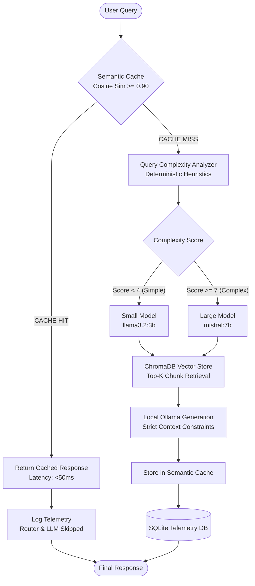

# RAG Cost Optimizer

> **A 100% Local, Zero-Commercial-API-Cost RAG System with Semantic Caching, Cost-Aware Model Routing, and Production Latency Telemetry.**

[](https://fastapi.tiangolo.com)
[](https://www.trychroma.com)
[](https://ollama.ai)
[](https://huggingface.co/sentence-transformers/all-MiniLM-L6-v2)
[](LICENSE)

---

## 📌 1. Project Overview

**RAG Cost Optimizer** is an open-source, offline-first Retrieval-Augmented Generation (RAG) framework designed to eliminate cloud LLM API costs and minimize local compute load.

By combining **Vector Semantic Caching** (Phase 2), **Deterministic Complexity-Aware Model Routing** (Phase 3), and **High-Resolution Latency Telemetry** (Phase 4), the system avoids unnecessary LLM inferences for repeated questions and routes lightweight queries to fast, smaller local models while reserving larger reasoning models for complex prompts.

All operations execute strictly on your local machine using **FastAPI**, **Sentence Transformers**, **ChromaDB**, and **Ollama**, ensuring **$0.00 external API costs** and complete data privacy.

---

## ✨ 2. Key Features

- **🛡️ 100% Offline & Free**: Operates entirely locally without cloud subscriptions (No OpenAI, Anthropic, or external API keys).
- **⚡ Semantic Cache (Phase 2)**: Computes cosine similarity across cached queries in ChromaDB; serves near-instantaneous responses on Cache HITs and completely bypasses LLM inference.
- **🧠 Cost-Aware Intelligent Routing (Phase 3)**: Dynamically evaluates query complexity using deterministic heuristics (length, multi-concept keywords, comparative clauses) to select between `llama3.2:3b` and `mistral:7b`.
- **⏱️ High-Resolution Latency Telemetry (Phase 4)**: Uses monotonic timers (`time.perf_counter()`) to measure Cache Lookup, Routing, Vector Retrieval, and Generation durations individually.
- **📊 AI Observability Dashboard**: Sleek, dark-mode web monitoring dashboard (`/dashboard`) with real-time Chart.js graphs, dynamic bottleneck detection, service health checks, and slide-out request detail inspection.
- **🔒 Strict Context Grounding**: Enforces strict system prompt constraints so answers are synthesized strictly from retrieved context, eliminating hallucinations.
- **💾 Persistent Local Storage**: SQLite database (WAL mode) for telemetry history and ChromaDB on disk to survive server restarts.

---

## 🏛️ 3. Architecture



---

## 🛠️ 4. Technology Stack

| Component | Technology | Purpose |
|---|---|---|
| **Web Framework** | [FastAPI](https://fastapi.tiangolo.com/) | Asynchronous REST API, validation, and auto-generated Swagger documentation |
| **Embeddings** | [Sentence Transformers](https://huggingface.co/sentence-transformers/all-MiniLM-L6-v2) (`all-MiniLM-L6-v2`) | Fast, local 384-dimensional dense vector embeddings |
| **Vector Database** | [ChromaDB](https://www.trychroma.com/) | Persistent local vector store for knowledge base chunks and semantic cache |
| **Local LLM Engine** | [Ollama](https://ollama.ai/) | Local inference runtime serving `llama3.2:3b` and `mistral:7b` |
| **Telemetry Storage** | SQLite (WAL mode) | Persistent local logging for latency, tokens, and model metrics |
| **Frontend Dashboard** | HTML5 / CSS3 / [Chart.js](https://www.chartjs.org/) | Modern dark-mode observability dashboard served at `/dashboard` |

---

## 📈 5. Project Development Phases

- **Phase 1: Local Baseline RAG**: Ingestion of text documents into ChromaDB, Sentence Transformer embeddings, and strict context-grounded LLM synthesis via Ollama.
- **Phase 2: Semantic Caching Layer**: Vector similarity lookup in ChromaDB (`semantic_cache` collection). Queries with cosine similarity $\ge 0.90$ reuse cached answers, bypassing retrieval and LLM generation.
- **Phase 3: Cost-Aware Intelligent Routing**: Deterministic complexity analyzer scoring query length, comparative clauses, and technical keywords. Simple queries route to `llama3.2:3b`, while complex reasoning queries route to `mistral:7b`.
- **Phase 4: Telemetry, Observability & Analytics**: End-to-end stage timing using `time.perf_counter()`, Ollama token extraction, persistent SQLite request storage, and an interactive web dashboard.

---

## ⚡ 6. How Semantic Caching Works

1. When a user submits a query, it is embedded into a 384-dimensional vector using `all-MiniLM-L6-v2`.
2. The vector is queried against the `semantic_cache` ChromaDB collection using cosine similarity.
3. If the nearest cached query has a cosine similarity $\ge 0.90$ (configurable via `SEMANTIC_CACHE_THRESHOLD`):
   - **Cache HIT**: The cached answer and sources are returned immediately.
   - Vector retrieval, query routing, and LLM inference are completely bypassed.
4. If similarity $< 0.90$:
   - **Cache MISS**: The request proceeds to complexity analysis, retrieval, and LLM generation, with the new result added to the cache for future queries.

---

## 🤖 7. How Cost-Aware Routing Works

The router calculates a deterministic complexity score ($0$ to $15+$) based on multiple factors:
- **Token / Word Count**: Multi-sentence or lengthy questions increase complexity.
- **Comparison & Analysis Keywords**: Words like `compare`, `difference`, `tradeoffs`, `versus`, `explain why` add score points.
- **Multi-Concept Indicators**: Queries connecting multiple domains or technical specifications (e.g. `1NF`, `2NF`, `BCNF`, `functional dependencies`).
- **Compound Questions**: Presence of multiple question marks or conjunctive clauses (`and also`, `additionally`).

### Routing Policy
- **Score $\le 3$ (Simple)** $\rightarrow$ Routed to **`llama3.2:3b`** (low latency, minimal memory footprint).
- **Score $4 - 6$ (Medium)** $\rightarrow$ Heuristic routing based on available resources.
- **Score $\ge 7$ (Complex)** $\rightarrow$ Routed to **`mistral:7b`** (multi-step reasoning).
- **Fallback Mechanism**: If the large model is unavailable in the local Ollama instance, the router gracefully falls back to the small model without crashing.

---

## ⏱️ 8. How Telemetry Works

Telemetry is collected at every step using Python's high-resolution monotonic clock (`time.perf_counter()`):
- `cache_lookup_latency_ms`: Duration of ChromaDB cache similarity search.
- `routing_latency_ms`: Duration of query complexity heuristic analysis.
- `retrieval_latency_ms`: Duration of document chunk vector search in ChromaDB.
- `generation_latency_ms`: Duration of local Ollama token generation.
- `total_request_latency_ms`: Complete end-to-end request lifecycle time.
- **Ollama Token Extraction**: Reads `prompt_eval_count`, `eval_count`, `load_duration`, and `eval_duration` directly from Ollama response metadata.

Telemetry records are saved to SQLite (`backend/data/telemetry.db`), enabling persistence across restarts.

---

## 📊 9. AI Observability Dashboard

Access the real-time monitoring dashboard at **`http://127.0.0.1:8000/dashboard`**.

### Dashboard Features:
- **KPI Overview**: Total requests, cache hit rate, avoided vs. executed LLM calls, average latency, and zero-cost confirmation.
- **Efficiency Impact**: Dynamic horizontal cache efficiency bar and avoided work counters.
- **Intelligent Model Routing**: Percentage distribution and latency comparison between `llama3.2:3b` and `mistral:7b`.
- **Latency Telemetry & Bottleneck Detection**: Stage breakdown bars with dynamic `[DOMINANT STAGE]` highlights and factual performance summaries.
- **Recent Telemetry Stream**: Interactive table with expandable slide-out **Request Detail Drawer** showing complete request metadata and token counts.
- **System Health**: Live operational status for FastAPI, Ollama, ChromaDB, and SQLite.

---

## 💻 10. Installation & Prerequisites

### Prerequisites
- **Python 3.10+**
- **Ollama** installed and running ([Download Ollama](https://ollama.ai))

### Setup Steps

1. **Clone the repository**:
   ```bash
   git clone https://github.com/your-username/rag-cost-optimizer.git
   cd rag-cost-optimizer
   ```

2. **Create and activate a virtual environment**:
   ```powershell
   # Windows (PowerShell)
   python -m venv .venv
   .\.venv\Scripts\Activate.ps1

   # Linux / macOS
   python3 -m venv .venv
   source .venv/bin/activate
   ```

3. **Install dependencies**:
   ```bash
   pip install -r requirements.txt
   ```

---

## 🦙 11. Ollama Setup

1. **Start the Ollama daemon**:
   ```bash
   ollama serve
   ```

2. **Pull the required models**:
   ```bash
   # Small model for simple queries
   ollama pull llama3.2:3b

   # Large model for complex reasoning
   ollama pull mistral:7b
   ```

---

## ⚙️ 12. Environment Configuration

Copy the example environment file and customize settings if needed:

```bash
cp .env.example .env
```

### Configuration Variables (`.env`)

| Variable | Type | Default | Description |
|---|---|---|---|
| `SEMANTIC_CACHE_ENABLED` | bool | `true` | Enable or disable the vector semantic cache |
| `SEMANTIC_CACHE_THRESHOLD` | float | `0.90` | Minimum cosine similarity required for a Cache HIT |
| `COST_ROUTING_ENABLED` | bool | `true` | Enable or disable complexity-based model routing |
| `SMALL_MODEL` | str | `llama3.2:3b` | Local Ollama model identifier for simple queries |
| `LARGE_MODEL` | str | `mistral:7b` | Local Ollama model identifier for complex queries |
| `SIMPLE_THRESHOLD` | int | `3` | Maximum complexity score for simple classification |
| `COMPLEX_THRESHOLD` | int | `7` | Minimum complexity score for complex classification |
| `OLLAMA_BASE_URL` | str | `http://127.0.0.1:11434` | Endpoint for the local Ollama REST API |
| `OLLAMA_TIMEOUT_SECONDS`| float| `180.0` | Maximum request timeout for local LLM generation |

---

## 🚀 13. Running the Backend

Start the FastAPI application with Uvicorn:

```bash
uvicorn main:app --reload --host 127.0.0.1 --port 8000
```

- **Web Dashboard**: `http://127.0.0.1:8000/dashboard`
- **Swagger Interactive API Docs**: `http://127.0.0.1:8000/docs`
- **Health Endpoint**: `http://127.0.0.1:8000/health`

---

## 📡 14. API Endpoints Reference

| Method | Endpoint | Description |
|---|---|---|
| `GET` | `/` | Root system status, indexed chunk counts, and model info |
| `GET` | `/health` | Health check endpoint |
| `POST` | `/api/chat` | Main query endpoint with semantic caching, routing, and RAG |
| `POST` | `/api/ingest` | Re-indexes `.txt` files from `backend/data/documents/` into ChromaDB |
| `GET` | `/api/cache/stats` | Returns semantic cache statistics (hits, misses, hit rate) |
| `DELETE` | `/api/cache` | Clears semantic cache entries and resets analytics counters |
| `GET` | `/api/analytics` | Aggregated telemetry (latency percentiles, stage averages, avoided calls) |
| `GET` | `/api/analytics/models` | Per-model request counts, average latencies, and error rates |
| `GET` | `/api/analytics/latency` | Stage-by-stage latency averages (Cache, Router, Retrieval, Generation) |
| `GET` | `/api/analytics/recent` | Recent telemetry records stream (supports `?limit=20`) |
| `GET` | `/dashboard` | Serves the HTML5 AI Observability Dashboard UI |

---

## 🧪 15. Testing & Verification

Run the automated test suites to verify end-to-end functionality:

```powershell
# Run Phase 3 Routing & Caching test suite
python test_phase3.py

# Run Phase 4 Telemetry, Analytics & Persistence test suite
python test_phase4.py
```

---

## 📝 16. Example Workflow

### 1. Ingest Knowledge Base Documents
```bash
curl -X POST "http://127.0.0.1:8000/api/ingest?force_reload=false"
```

### 2. Simple Query (Cache MISS $\rightarrow$ `llama3.2:3b`)
```bash
curl -X POST "http://127.0.0.1:8000/api/chat" \
     -H "Content-Type: application/json" \
     -d '{"query": "What is DBMS?"}'
```

### 3. Repeated Query (Cache HIT $\rightarrow$ Instant Response, LLM Bypassed)
```bash
curl -X POST "http://127.0.0.1:8000/api/chat" \
     -H "Content-Type: application/json" \
     -d '{"query": "What is DBMS?"}'
```

### 4. Complex Query (Cache MISS $\rightarrow$ `mistral:7b`)
```bash
curl -X POST "http://127.0.0.1:8000/api/chat" \
     -H "Content-Type: application/json" \
     -d '{"query": "Compare 1NF, 2NF, 3NF and BCNF with examples, explain functional dependencies and discuss when each normalization level should be used."}'
```

---

## 📁 17. Project Structure

```text
rag-cost-optimizer/
├── backend/
│   ├── app/
│   │   ├── cache/
│   │   │   ├── __init__.py
│   │   │   └── semantic_cache.py       # ChromaDB semantic vector cache
│   │   ├── monitoring/
│   │   │   ├── __init__.py
│   │   │   ├── metrics.py              # Aggregations, percentiles, stage breakdowns
│   │   │   ├── storage.py              # SQLite WAL persistent telemetry storage
│   │   │   └── telemetry.py            # TelemetryRecord schema definition
│   │   ├── router/
│   │   │   ├── __init__.py
│   │   │   └── query_router.py         # Query complexity analyzer & model router
│   │   ├── static/
│   │   │   └── dashboard.html          # Enterprise AI Observability Dashboard
│   │   ├── analytics.py                # Analytics tracking bridge
│   │   ├── config.py                   # Pydantic settings & environment configuration
│   │   ├── embeddings.py               # Sentence-Transformers embedding manager
│   │   ├── ingestion.py                # Document chunking & loader
│   │   ├── llm.py                      # Ollama client with latency & token telemetry
│   │   ├── logging_config.py           # Structured logging configuration
│   │   ├── rag_service.py              # End-to-end RAG pipeline coordinator
│   │   ├── schemas.py                  # Pydantic request & response models
│   │   └── vector_store.py             # ChromaDB persistent collection client
│   ├── data/
│   │   ├── documents/                  # Text files for knowledge base ingestion
│   │   ├── chroma_db/                  # (Git-ignored) Local ChromaDB storage
│   │   └── telemetry.db                # (Git-ignored) SQLite telemetry database
│   └── main.py                         # FastAPI application & route definitions
├── main.py                             # Root Uvicorn entrypoint
├── test_phase3.py                      # Phase 3 automated test suite
├── test_phase4.py                      # Phase 4 automated test suite
├── requirements.txt                    # Project dependencies
├── .env.example                        # Template for environment configuration
├── .gitignore                          # Professional Git ignore rules
└── README.md                           # Comprehensive documentation
```

---

## ⚠️ 18. Limitations

- **Local Hardware Dependency**: Generation latency is directly tied to the host system's CPU/GPU capabilities.
- **Context Window Constraints**: Context size is determined by the selected Ollama model's context length.
- **Compute Costs vs. API Costs**: While external commercial API costs are strictly **$0.00**, local hardware electricity and compute usage are not tracked as monetary currency.

---

## 🔮 19. Future Improvements

- **Configurable Hardware Compute Cost Model**: Optional $/kWh or $/GPU-hour estimation for hardware energy tracking.
- **Adaptive Similarity Threshold**: Dynamic similarity threshold adjustments based on query entropy.
- **Multimodal Document Ingestion**: Support for PDF, DOCX, and Markdown parsing with table extraction.
- **Hybrid Retrieval**: BM25 keyword search combined with dense vector embeddings via reciprocal rank fusion (RRF).

---

## 📄 20. License

This project is licensed under the **MIT License** — see the [LICENSE](LICENSE) file for details.
